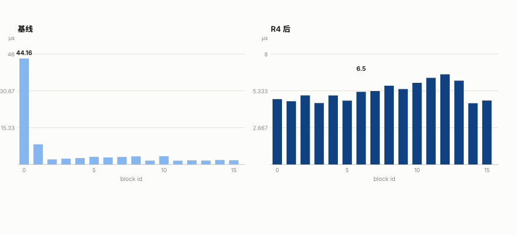
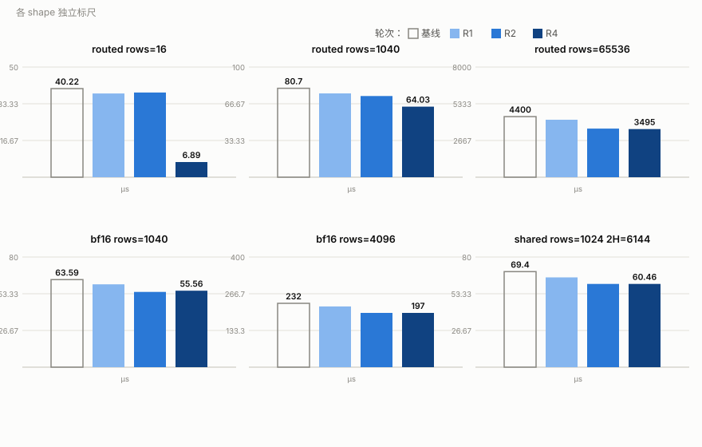
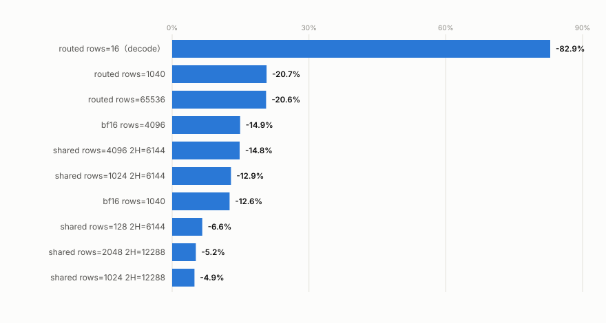

# dequant_situ_quant 融合算子 Ascend 性能优化报告

## 1. 背景

Kimi K3 的 W4A8 量化推理里，MoE 的 gate_up 矩阵乘（GMM1）输出后需要一串后处理：把 int32 或 bf16 的矩阵乘结果过 **Situ 激活**（`β·tanh(gate/β)·σ(gate)·linearβ·tanh(up/linearβ)` 的 tanh-sigmoid 门控组合），再逐行动态量化成 int8 喂给 down 矩阵乘。vLLM Ascend 插件的自研算子 **`dequant_situ_quant`** 把「反量化 → Situ 激活 → 动态量化」融为一个 kernel。它与 W8A8 的 `dequant_swiglu_quant`（SwiGLU 版）同族，但激活函数与调用方都不同：用于 Kimi K3 的共享专家与路由专家，每层每次前向必调。

本文档总结该算子在 Ascend 910B3 上的性能优化：先以设备上的 tiling key 确认生产命中的 kernel，再按「等价消 pass → 行间流水 → 负载再分配」三轮推进，其中一轮在设备上抓到并修复了行循环的队列错误。优化全程位级等价（不改每行的计算输入与指令路径，只删冗余、改调度），每轮以同一套精度测试把关。

### 测试环境

| 项目 | 值 |
|------|-----|
| 设备 | Ascend 910B3（dav_c220 向量核），40 AIV，UB 192KB/核 |
| CANN | 9.1.0 |
| 模型场景 | Kimi K3 W4A8：路由专家 2H=6144（GMM1 后处理），共享专家 2H=12288/TP 度 |
| 测试矩阵 | shared：rows=1/4/16/64/128/512/1024/2048（2H=12288）与 1/16/128/1024/4096（2H=6144）；routed：rows=16/1040/65536（2H=6144）；bf16：rows=1/16/1040/4096（2H=6144） |
| 计时口径 | NPUGraph capture+replay（≈背靠背 serving，5 样本取中位）作性能记分板；msprof op（PipeUtilization 与 TimelineDetail 指令级流水图）作管线归因，两者绝对耗时不直接混用 |

### 算子契约

```text
int32 路径:  f = fp32(x_int32) × weight_scale[expert,2H] × activation_scale[row] (+ bias)
bf16 路径:   f = fp32(x_bf16)                                   # GMM1 已反量化
gate   = f 左半（activate_left=1）, up = f 右半
situ_a = β·tanh(gate/β) · σ(gate)
up'    = linearβ·tanh(up/linearβ)          # linear_beta>0 时；生产 bf16 调用为 0
situ   = situ_a · up'
scale  = max|situ行| / 127 (fp32, 逐行, 0 → 1)
y      = int8( RINT(situ/scale) 经 half 中转 TRUNC )
```

数值链 fp32 → RINT → int32 → half(ROUND, deq 1.0) → int8(TRUNC)；half 中转对[-127,127] 的整数值无损。生产调用里 bf16 路径 β=1.0、linear_beta=0（tanh(β⁻¹x)·β 退化为 tanh(x)，up 无 clamp 链），int32 路径 β=4.0、linear_beta=25.0。

---

## 2. 算子在大模型中的位置与数据

### 2.1 位置

```text
token embeddings
  → N × decoder layer（Kimi K3 W4A8，MoE）
       共享专家: npu_quant_matmul(int32 out) → 【dequant_situ_quant】→ int8 ↓proj
       路由专家: grouped_matmul（int32 或 bf16 out，split_item=2）
                 → 【dequant_situ_quant】→ int8 + 逐行 scale ↓proj   ← 每层必调
```

三个调用方的参数画像（`shared_experts.py:382`、`w4a8.py:476` 及其 routed 变体）：

| 调用方 | x | 附属输入 | 2H |
|---|---|---|---|
| 共享专家 | int32 [rows, 2H] | weight_scale [2H]，activation_scale [rows] | 12288/TP |
| 路由专家（int32） | int32 [tokens×topk, 2H] | weight_scale/bias [E,2H]，group_index [E] | 6144 |
| 路由专家（bf16） | bf16 [rows, 2H] | 无（GMM1 直接输出 bf16） | 6144 |

### 2.2 分派实证：先确认生产命中的 kernel

op_kernel 按 x 的 dtype 编译期分派三套实现，tiling 侧对 int32/bf16 直接整行进 UB（baseColLen=outDimy，无列切分），int8 才有 UB 预算推导的列切分。以 msprof `OpBasicInfo.csv` 记录的 kernel 名后缀（tiling key）核对设备实际命中：

| x dtype | tiling key（设备实证） | kernel | 生产调用方 |
|---|---|---|---|
| int32 | **30000**（`DequantSituQuant_155c…_30000`，Block Dim 40） | `DequantSituQuantK3Kernel<int32_t>` | 共享 + 路由 |
| bf16 | **40000**（`DequantSituQuant_f54a…_40000`，Block Dim 40） | `DequantSituQuantK3Kernel<bfloat16_t>` | w4a8 预反量化 |
| int8 | 列切分模板 | `DequantSituQuantKernel`（旧版） | **无生产调用方**，只保回归 |

三个生产调用方全部命中 `DequantSituQuantK3Kernel`（下称 K3 kernel），本轮只优化它；int8 旧 kernel 保持原样，作为未动路径对照。K3 kernel 的 tiling 为整行进 UB：bf16 2H=6144 每核缓冲约 78KB，int32 2H=6144（含 bias）约 126KB，int32 共享 2H=12288 约 150KB，均在 192KB 内。

### 2.3 基线画像（msprof PipeUtilization）

| shape | aiv_time/核 | vec | mte2 | mte3 | scalar |
|---|---:|---:|---:|---:|---:|
| bf16 rows=1040 | 65.1µs | 75.0% | 15.0% | 5.9% | 15.4% |
| shared rows=1040（2H=12288） | 116.4µs | 78.0% | 17.1% | 3.4% | 8.5% |
| routed rows=16 | 均值 5.4µs | 8.2% | 18.8% | 0.5% | 81.0% |

静态走读的 K3 kernel 数据流（bf16 路径，H=3072 每行）：Cast 反量化 1 遍 2H 宽，Situ 数学约 8 遍 H 宽 pass（含 σ(gate) 的 Muls/Exp/Adds/Div 四遍），量化链 Abs、Max 链、WholeReduceMax、每行一次 V_S 标量往返取 scale、Muls 与三段 Cast。三个信号：

1. **大 rows 是 vec-bound**（vec 75% 至 78%），MTE2 仅 15% 至 17% 且被行间串行压着——行循环 `CopyIn → Compute → CopyOut` 逐行排队，三流水零重叠；
2. **routed rows=16 是负载失衡**，不是计算瓶颈：16 个激活核里 block0 独扛 **44.16µs**（14 个 expert 串行 ProcessGroup，每组重搬 48KB 的 weight_scale+bias 再算 1 行），其余核只做 14 次 group_index 标量读（vec 1%、scalar 75% 至 99%）后全程空转；
3. scalar 占 8.5% 至 15.4%，来源是每行的 V_S 往返与 int32 路径每行的 activation_scale 标量读，具体占比待隔离。

---

## 3. 优化总览

| 轮次 | 手段 | 针对的问题 | 结果 |
|---|---|---|---|
| R0 | 基线采集：NPUGraph 记分板 + pipe/指令级流水图 | 无基线无法判定收益与无回退 | ✅ 精度 16/16，全 shape 记分板与 pipe 画像落档 |
| R1 | 位级等价消 pass：Adds 拷贝、β=1 无效 Muls 对、H 宽 ones 广播改 8 元素块、双重 WholeReduceMax | 每行 15 至 21 个 H 宽 pass 中 4 个冗余 | ✅ 各档 -4.8% 至 -7.7%（rows=1 除外） |
| R2 | 行间双缓冲：xQueue/outQueue 深度 2 + 下一行预取，tiling 按 UB 预算与每核行数门控 | 行间串行使 MTE2 无法藏进 V | ✅ 多行 shape 再 -3.1% 至 -15.4%；⚠️ 首版 depth=1 漏发 CopyIn 被精度测试抓住（详见 4.3） |
| R3 | 标量域消除（评估后缓做） | 每行 V_S 往返、activation_scale 标量读 | ⛔ 负结果留档：收益 2% 至 8% 不足以覆盖风险（详见 4.4） |
| R4 | routed 行级负载再分配 | decode 每组 1 至 2 行压在 block0，其余核空转 | ✅ routed decode **-82.9%（5.8 倍）** |

**经验法则**：先用设备实证钉死分派 → 精度回归先行 → 等价变换减 pass → 流水化先过 UB 预算与每核行数两道门 → 负载失衡看每核忙碌分布再动手 → 每步用未动路径（int8 旧 kernel、depth=1 形态）校准噪声。

---

## 4. 逐轮优化过程

### 4.1 R0：基线与精度

性能改动前先落三样东西：未改动代码上的精度回归（`test_dequant_situ_quant.py`，覆盖 routed 多专家含零行组、bf16 预反量化 rows=1/16/1040、共享专家全 TP 档、零行空输出，**16/16 通过**）；三种生产变体 × 全 rows 档位的 NPUGraph 记分板（含与 unfused 参照组合的加速比核对，各档 4.2 倍至 21.2 倍）；2.3 节的 pipe 画像。基线各档绝对值见 4.7 总表。

### 4.2 R1：位级等价消 pass（各档 -4.8% 至 -7.7%）

四项变换，每项只删冗余、不改计算路径：

```cpp
// ① Adds(sigmoid, gate, 0.0f) 纯拷贝 + Muls(-1) 两拍 → Muls(denom, gate, -1.0f) 一拍
//    （-0.0/+0.0 符号差经 Exp/Adds(+1) 后无观测路径）
// ② beta == 1 时跳过 Muls(gate, 1/β) 与 Muls(gate, β)（×1.0f 为 IEEE 位级恒等）
//    —— bf16 生产调用恒传 β=1.0，省 2 个 H 宽 pass；β=4 的 int32 路径不受影响
// ③ 每行 Duplicate(ones, 1.0f, H) + Div(sigmoid, ones, sigmoid, H)
//    → 8 元素 ones 块 + stride-0 广播 Div（主 kernel 同款官方范式），
//      同时把 Div 的 dst 与 src1 分离到不同缓冲，规避 c220 dst==src1 风险
// ④ DynamicQuant 里 ComputeReduceMax 收尾的 WholeReduceMax 之后
//    又做了一次同参数 WholeReduceMax——幂等重复，删
```

结果：shared/bf16/routed 全部 rows 档 -4.8% 至 -7.7%，仅 bf16 rows=1 持平（launch 地板，-0.5%）。pipe 复测显示 vec 占比只从 75.0% 移到 72.9%（bf16 rows=1040）——**被消的都是廉价 pass（Muls/Add/Duplicate 每周期 64 lane），昂贵的 Tanh/Exp/Div 原样保留**。这条读数决定了后续方向：继续压 vec 时间要么靠流水重叠藏 MTE2/标量，要么动超越函数（无数值等价途径，不做）。

### 4.3 R2：行间双缓冲（多行 shape 再 -3.1% 至 -15.4%）

**设计**。行循环改为 prologue + 预取：`CopyIn(row0)` 提出循环，每轮先发 `CopyIn(row+1)` 再 `Compute(row)`，下一行的 MTE2 拷贝与当前行的 V 计算重叠。两道门控决定哪些 shape 启用：

1. **UB 预算**：深度 2 的缓冲需求 = 2×(x 行 + 输出行) + 常驻参数（weight_scale/dequant + bias）+ 临时缓冲，按 kernel InitBuffer 布局逐项核算，超出 192KB 则回退深度 1。结果是 2H=6144 的三族与 bf16 全档启用，**2H=12288 的 int32 共享路径（需 210KB）保持深度 1**；
2. **每核行数**：`rows/usedCoreNum ≥ 2` 才启用——每核 1 行时无行可预取，纯增开销。

**设备上抓到的错误（留档）**。首版行循环在深度 1 时也把 CopyIn 提出了循环，prologue 只拷了首行，后续行 DeQue 空队列——`prefill_m65-tp1`（rows=65、2H=12288、每核 2 行、深度 1）触发 aivec 异常（MTE 非法 GM 地址），16 个精度用例 6 红；其后的 tp2 至 tp16 失败是设备毒化后的连坐（深度 2 的 bf16/routed 全过佐证）。修复：深度分支——深度 1 循环内重发当前行 CopyIn（保持旧时序），深度 2 才预取下一行。教训与 skill 的「发射条件=消费条件」同源：**改行循环时必须逐深度核对每行的 CopyIn 恰好发一次**。

**证据链**（bf16 rows=1040）：

| 指标 | 基线 | R1 | R2 |
|---|---:|---:|---:|
| msprof Task Duration | — | 65.96µs | **55.54µs** |
| 三流水占比合计（vec+mte2+mte3） | 95.9% | 96.6% | **114.7%** |
| vec / mte2 / mte3 | 75.0 / 15.0 / 5.9% | 72.9 / 17.8 / 5.9% | 84.3 / 22.9 / 7.5% |

合计超过 100% 即存在跨流水重叠：R2 的 mte2 busy 占比升到 22.9% 的同时墙钟反降 15.8%，说明拷贝确实藏进了 V。指令级流水图（rows=128，`traces/dsq_situ_{pre,post}R2_bf16_128/`）给出直接证据：post-R2 时间线中下一行的 MTE2 拷贝（ts 1.44/1.85µs 发射）落在当前行 V 实质计算窗口（VCONV 起 ts 2.05µs）内执行，core0 的三流水并行度（忙碌并集 ÷ 墙钟）1.12 → 0.96。同一份 trace 也解释了 rows=128 档收益小的原因：启动期约 1.6µs 的标量发射空窗（0.43µs 首行数据就绪、2.05µs 才开始算）主导墙钟，行数越多摊得越薄——与记分板「收益随每核行数单调增」一致。

### 4.4 R3：标量域消除——评估后缓做

两个子项均完成评估、未进入实现，理由留档避免重复推导：

1. **activation_scale 广播**（int32 路径每行 `activationScaleGm_.GetValue(rowIdx)` 改为 Process 起点批量 MTE2 进 UB + Gather 块广播 Mul）：位级等价可行（antiquant_c220 与主 kernel 有同款先例），但只惠及 int32 两族——bf16 主力族没有这个标量读；shared int32 的 scalar 占比仅 8.5% 至 9.2%，且 GM 读延迟已部分被 Mul(weightScale) 的发射重叠掩盖。预期收益 2% 至 7%，收益与改动比不足。
2. **V_S 往返向量化**（scale 留向量域，`Div(ones, scale)` 替代标量 1/scale 再 Muls）：零保护（scale==0 → 1，避免 0×inf=NaN）需要 float Compare/Select——**c220 上仓内无先例**（float Compare 只有 arch35 MicroAPI 用法），v220 掩码张量的 dtype 语义需实测探针先行。bf16 的 scalar 占 22.4%，其中 V_S 停等只占一部分且已被 R2 流水部分掩盖。若后续推进：先写单核探针验证 Compare<float> 的掩码 dtype，再动 kernel。

### 4.5 R4：routed 行级负载再分配（decode -82.9%）

基线画像里 routed decode 的问题不是算得慢，而是**分派不均**：grouped 路径按 expert 串行，每组 `ceil(组行数/40)` 个核干活，decode（14 组、每组 1 至 2 行）时 14 组循环全部压在 block0——44.16µs 里 14 次参数搬运 + 14 行计算串行，其余 15 个核做完 14 次 group_index 标量读就退场。

改为**行级均摊**：`rowsPerCore = ceil(rowLen/usedCoreNum)` 对全体行分配，每核用标量游标按行解析所属 expert（group_index 的 E 次标量读，与旧版总量相同），仅在游标跨 expert 时重载 weight_scale/bias。三处细节：

- 游标扫描与参数加载分离：跳过的零行组不触发参数拷贝；
- `ReadExpertRows` 保留旧版对 remaining 的钳制语义（尾部超量吸收进最后的非空组）；
- 非分组 int32 与 bf16 走同一段行循环，参数段被 constexpr 剔除，行为与旧版逐位一致。

每行的计算输入（x、该行 expert 的 weight_scale/bias、activation_scale）与旧版完全相同——位级等价，只动调度。结果：

| shape | R2 | R4 | Δ vs R2 |
|---|---:|---:|---:|
| **routed rows=16（decode）** | 38.46µs | **6.89µs** | **-82.1%** |
| routed rows=1040 | 73.72µs | 64.03µs | -13.1% |
| routed rows=65536 | 3531.96µs | 3495.33µs | -1.0% |
| shared / bf16 全档 | — | — | ±2%（噪声带） |

每核分布的实测（msprof，routed rows=16）：基线 block0 44.16µs 独扛、其余核 1.6 至 8.4µs；R4 后 16 个激活核全部 4.5 至 6.5µs（vec 0.41 至 0.46、scalar 0.46 至 0.54），Task Duration 40µs 级降至 **7.24µs**。decode 墙钟（6.89µs）已与每核忙碌时间（4.5 至 5µs，含一次 48KB expert 参数搬运与单行全链计算）同量级；进一步压需要减少单行 pass 数（R1 已做）或让参数跨核共享（MTE2 各核独立，做不到）。



### 4.6 回退风险与适用范围

| 场景 | 本次观测 | 说明与边界 |
|---|---|---|
| rows 小于等于 16 的各档 | 单次采样在 -8% 至 +8% 间漂移，同 build 重跑同一档也漂约 4% | 深度门控后这些 shape 的 kernel 行为与基线一致，读数差异属共享宿主噪声；不能用单次采样宣称回退或收益 |
| shared 2H=12288 全档 | R2 无收益亦无回退（±2%），累计收益 4.9% 至 5.2% 全部来自 R1 | UB 核算显示该族需 210KB，双缓冲放不下；若要流水需先压缩常驻缓冲（weight_scale/bias 各 48KB） |
| 非法输入（sum(group_index) < rowLen） | 行为有定义域内的变化：旧版尾部行不被任何 expert 处理（y 保持 GM 原值），新版尾部行按最后一个非空 expert 的参数处理 | 生产契约恒 rowLen == sum（调用方构造保证），tiling 侧无此断言；如需严格复刻旧行为可在游标到达最后一个 expert 后截断 localRows |
| 精度 | 四轮每轮 16/16 全绿 | 全程位级等价（每行计算输入与指令路径不变）；量化链的数值链未动 |

### 4.7 总收益与最终状态

**累计优化（NPUGraph，µs，5 样本中位）**：

| shape | 基线 | +R1 | +R2 | +R4 最终 | 累计 |
|---|---:|---:|---:|---:|---:|
| routed rows=16（decode） | 40.22 | 38.02 | 38.46 | **6.89** | **-82.9%（5.8 倍）** |
| routed rows=1040 | 80.70 | 76.09 | 73.72 | **64.03** | **-20.7%** |
| routed rows=65536 | 4400.47 | 4176.17 | 3531.96 | **3495.33** | **-20.6%** |
| bf16 rows=4096 | 231.74 | 220.57 | 197.09 | **197.06** | **-14.9%** |
| shared rows=4096 2H=6144 | 251.48 | 237.88 | 214.89 | **214.14** | **-14.8%** |
| shared rows=1024 2H=6144 | 69.40 | 65.21 | 60.49 | **60.46** | **-12.9%** |
| bf16 rows=1040 | 63.59 | 60.20 | 54.68 | **55.56** | **-12.6%** |
| shared rows=128 2H=6144 | 17.38 | 16.05 | 15.44 | **16.23** | **-6.6%** |
| shared rows=2048 2H=12288 | 213.63 | 200.88 | 203.27 | **202.62** | **-5.2%** |
| shared rows=1024 2H=12288 | 110.89 | 104.13 | 105.75 | **105.40** | **-4.9%** |

rows 小于等于 16 的各档处于正负 8% 噪声带，未列入收益结论。中间档位（rows=64/128/512）同向，全量数据见 `原始数据/bench_*.json`。





**最终态管线画像**（bf16 rows=1040，msprof）：Task Duration 55.54µs，vec busy 84.3%、mte2 22.9%、mte3 7.5%、scalar 22.4%——三流水合计 114.7%，MTE2 已大量藏入 V；scalar 占比升高是墙钟缩短后固定标量成本的占比效应，绝对时长未变，其中 V_S 停等与指令发射的占比待隔离（4.4 节的 R3b 若推进需先解决探针）。继续优化的空间按实测排序：decode 路径已贴近单行地板；大 rows 路径的 vec 占 84.3%，进一步下降需要减少超越函数遍数或拆分 pass 粒度，均无数值等价途径，当前未见可行动作。

---

## 5. 归因速查表与关键经验

### 5.1 归因速查表

| 症状 / 问题 | 看什么 | 本例读数 → 结论 |
|---|---|---|
| 不确定优化对象 | msprof `OpBasicInfo.csv` 的 kernel 名后缀（tiling key） | 三个生产调用方命中 key 30000（int32）/ 40000（bf16）对应的 K3 kernel；int8 旧 kernel 无调用方 |
| msprof 采集为空（OPPROF 目录无文件） | kernel-name 拼写 | 运行时符号是驼峰 `DequantSituQuant_<hash>_<key>`，小写 extern C 名匹配不到，用 `DequantSituQuant*` 通配 |
| 行循环改流水后 aivec 崩溃（MTE 非法 GM 地址） | 逐深度核对每行的 CopyIn 次数 | depth=1 首行后 DeQue 空队列；后续用例连坐是设备毒化，先修真因再看余波 |
| 双缓冲墙钟不降，pipe busy 也不动 | 每核行数 | rows≤40 时每核 1 行，无行可预取——门控关闭后回到基线行为 |
| 流水是否真的重叠 | 指令级流水图（TimelineDetail trace.json）的并行度（三流水忙碌并集 ÷ 墙钟） | 1.12 → 0.96，且后行 MTE2 拷贝落在当前行 V 窗口内；pipe 占比合计 114.7% 是同一事实的指标级佐证 |
| 小档读数漂移 | 未动路径 + 同 build 复测 | rows≤16 各档 ±8%、同 build 重跑漂约 4%，属共享宿主噪声，不据此宣称回退 |
| routed decode 慢但 vec 占比低 | 每核忙碌分布（PipeUtilization 按块拆） | block0 44.16µs 独扛、其余核空转 → 负载失衡，改分派而非改计算 |

### 5.2 关键经验

1. **分派实证先于一切**：多变体算子先用设备上的 tiling key 钉死生产命中的 kernel；本算子三套实现里只有 K3 有生产调用方；
2. **负载失衡与计算瓶颈的处方完全不同**：decode 路径 5.8 倍的收益来自改分派（行级均摊 + 按需参数加载），kernel 内部的 pass 数一行都没少；先看每核忙碌分布，再决定是改计算还是改调度；
3. **流水化的两道门**：UB 预算按 kernel InitBuffer 布局逐项核算（2H=12288 放不下就诚实回退深度 1），每核行数不足 2 不开预取——两道门都不开时必须与旧时序逐拍一致；
4. **行循环改动的精度风险在队列语义而非数学**：本轮唯一的设备事故是 depth=1 漏发 CopyIn，不是数值错误；「每行 CopyIn 恰好一次」要按深度分支逐条核对；
5. **消 pass 前先分廉价与昂贵**：Muls/Add/Duplicate 每周期 64 lane，Tanh/Exp/Div 是多周期超越函数——本轮 R1 消掉 4 个廉价 pass 只换来 5% 至 7%，说明 vec-bound 段的大头在超越函数，无数值等价途径就不硬啃；
6. **归因要多口径互相印证**：bench 定收益、PipeUtilization 定方向、指令级 trace 定机制——R2 的重叠结论是三者一致才下的；pipe busy 合计不足 100% 时重叠不存在，超过 100% 才有；
7. **负结果与门槛完整留档**：R3 两个子项（收益不足、无设备先例）、小档噪声带、2H=12288 的 UB 上限，各带判据，避免未来重推。
