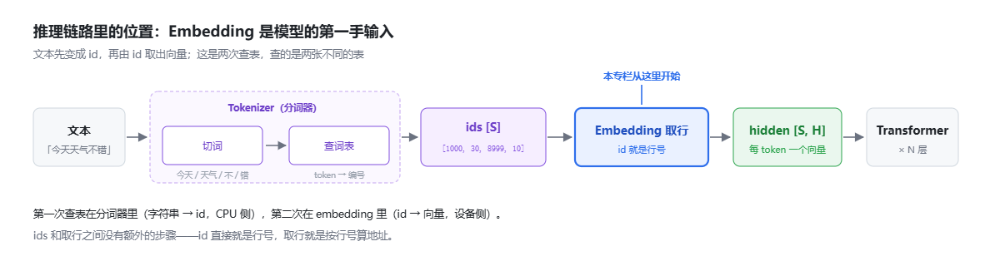
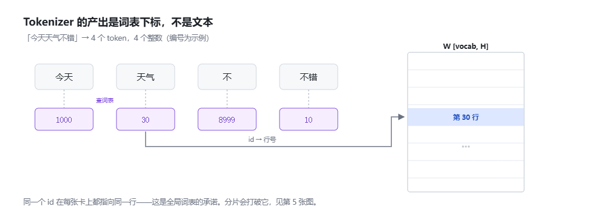
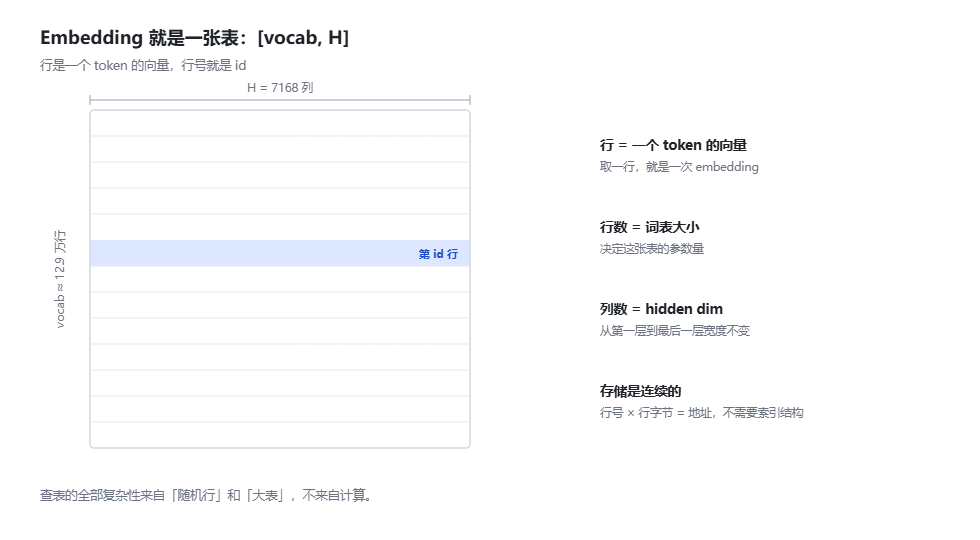
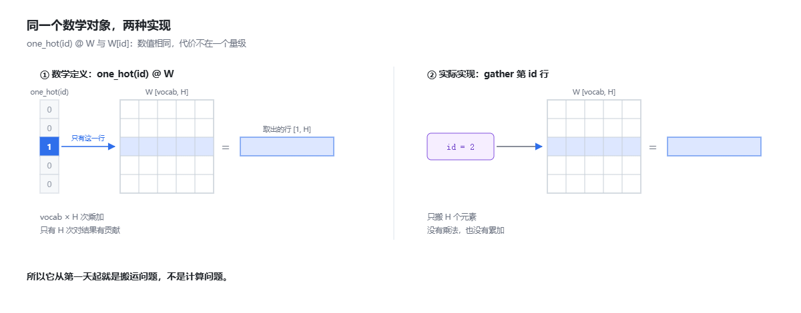
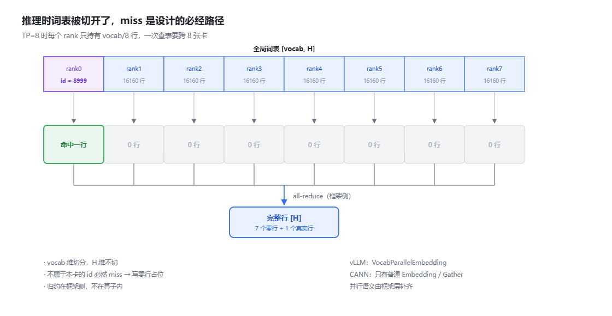
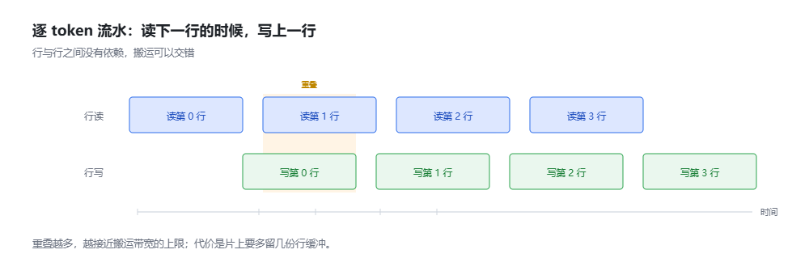
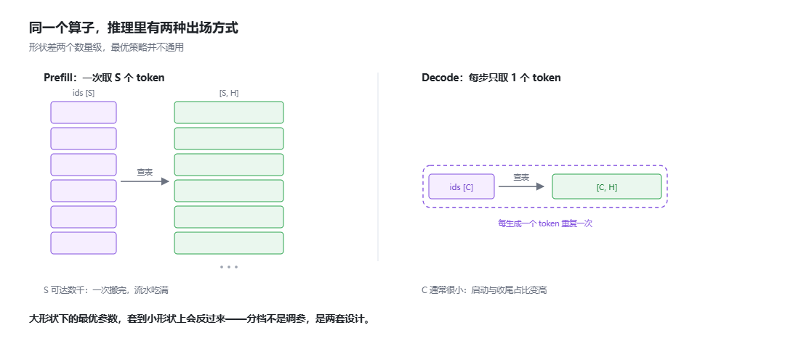
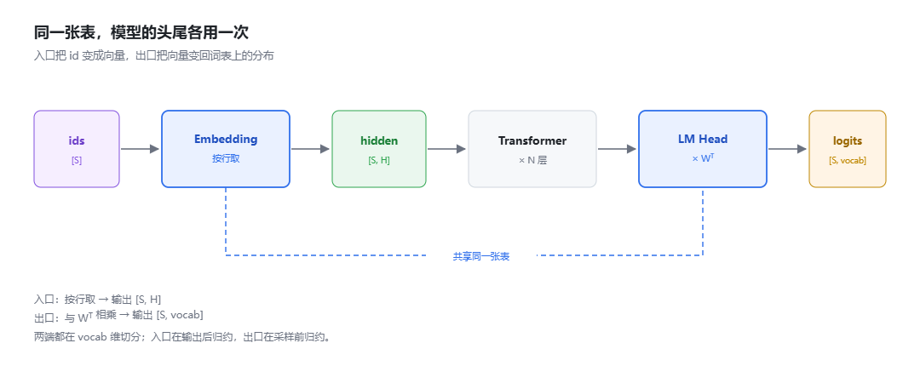

# Embedding 简述及算子分析

> 从 token id 到访存路径：vLLM 实现与 Ascend 算子设计
>
> 完善版 · 2026-11-13

---

> **摘要**
>
> Embedding 是把 token id 映射为向量的查表操作。它几乎没有有效浮点计算，性能主要由访存路径、TP 切分后的集合通信以及形状分档决定。本文先说明 tokenizer 与 embedding 两次映射的区别，再讨论输入/权重、访存模型、TP 并行、vLLM 的实现路径，以及按行流水、无条件搬运、按形状分档三个实现取向，并给出一个不展开代码的算子设计骨架（接口、分核分块、片上缓冲、查表路径、形状分档、正确性与性能验收）。文中以文本 LLM 为范围，框架层以 vLLM 为主，实现层兼顾 Ascend/CANN；不同版本的实现差异会在文中注明。

**关键词：** Embedding；访存；张量并行；vLLM；Ascend

> **阅读说明**
>
> 本文把“框架层路径”和“单算子职责”分开讨论：vLLM 的 `VocabParallelEmbedding` 是层/模块级实现，包含 mask、置零、集合通信；CANN 侧的 `Embedding`/`Gather` 算子通常只负责本地查表，分片语义由框架补齐。文中涉及 vLLM 的行为以当前 main 分支为参考，不同版本会有差异；文中示例取 DeepSeek-V3 的 `H = 7168`、`vocab = 129280`，用于说明 TP 分片。

## 一、引子：一句话如何变成向量

把一句话喂给文本大模型，通常要经过分词（tokenize）→ token id → embedding 三个环节，才能得到模型可以处理的向量。

以“今天天气不错”为例，分词器可能把它切成“今天 / 天气 / 不 / 错”四个子词，再映射为 token id，例如 `1000、30、8999、10`（仅为示意），最后通过 embedding 取出四行向量。

这个过程包含两次映射：第一次是 tokenizer 把文本映射为词表下标，第二次是 embedding 把 id 当成行号，从参数矩阵中取出对应行。本文关注第二次。

*图1 推理链路中的位置：文本先变成 id，再由 id 取出向量。两次查表查的是两张不同的表。*

> **教学简化**
>
> 分词器并不是先得到完整词再查 id 的两段式；BPE 等子词分词器是“子词合并 + 词表映射”一次完成。这里拆成两步，只是为了和 embedding 的查表对照。

工程上，tokenizer 的词表与 embedding 权重的 vocab 在逻辑上对应，但不一定完全相等：为对齐/并行会做 padding，也可能有 added token（如 LoRA 新增 token）。下文默认忽略这些细节，只保留“id 是全局词表下标”的主线。

*图2 Tokenizer 的输出是词表下标，不是文本；同一个 id 在所有卡上应指向同一行，这是全局承诺。分片会打破这个承诺，见图5。*

## 二、Embedding 的输入与权重

从查表实现看，embedding 的核心输入只有两个张量：`ids` 和 `weight`。

### 2.1 输入 ids

`ids` 是整数下标，不是文本。实现中常见 `int32` 或 `int64`；vLLM 的非融合路径在调用底层 embedding 前会转成 `long`（`int64`），融合 kernel 的下标 dtype 则由底层算子处理。

形状方面，框架层（如 `nn.Embedding`）的输入可以是 `[batch, seq]` 或任意前导维；vLLM 内部通常先展平为 `[num_tokens]` 再查表，最后恢复为“输入形状 + `[H]`”。前导维只决定 token 的排布和输出偏移，不影响“取哪一行”。因此，把输入理解为 `[num_tokens]` 是 kernel 视角的简化，不应写成 embedding 只接受 `[num_tokens]`。

有效 id 的范围是 `[0, vocab-1]`；若存在 added vocab，上界是逻辑词表大小。padding 行不是用户可输入的 id。

每个 token 独立处理：第 i 个 token 取哪一行，与第 j 个 token 无关。

### 2.2 权重 W

`W` 的形状是 `[vocab, H]`：行数是逻辑词表大小，列数是隐藏维度 `H`。行主序连续存储时，第 `id` 行的起始偏移是 `id × H × sizeof(dtype)`（忽略分片偏移和量化 stride）。

`H` 在标准 Transformer 的残差流中保持不变：embedding 输出进入残差流，注意力输出投影和 MLP 的 down projection 都会把结果映射回 `H`，才能与残差相加。

注意：实际权重可能按 TP 分片、按 padding 对齐，甚至量化；此时本地行数、行 stride 和元素字节数都要按实际布局计算。本文默认未量化、行主序。

*图3 Embedding 是一张 `[vocab, H]` 的表；行号就是 id，取一行就是一次 embedding。示例 `H = 7168`（DeepSeek-V3）。*

## 三、Embedding 的访存本质

按数学定义，embedding 可以等价写成矩阵乘法：`Out = one_hot(ids) @ W`。`one_hot(ids)` 的形状是 `[N, vocab]`，`W` 是 `[vocab, H]`，结果是 `[N, H]`。

对每个 token 来说，这次乘加有 `vocab × H` 次，但只有 `H` 次乘的是 1，其余都在乘 0；实际实现不会真的构造 one-hot，而是按 id 取行（gather）。

gather 没有有效浮点乘加，但有地址计算、mask、clamp/置零等标量或逐元素工作。因此更准确的说法是：有效浮点计算为 0，而不是所有计算都为 0。

单卡、忽略索引读取时，理论搬运量是：读 `W` 一行 `H` 个元素 + 写 `Out` 一行 `H` 个元素，共 `2 × N × H × sizeof(dtype)` 字节。实际还要读 `ids`（`N × sizeof(id)`），并受随机行访问、DMA 粒度、对齐和有效带宽影响。

所以 embedding 的性能主要取决于数据搬运：本地随机行读、输出写、TP 集合通信，以及 kernel 启动/调度开销。“让搬运更顺”是主要方向，但不是唯一方向。

*图4 one-hot 矩阵乘与按行 gather 数值等价，但代价不在一个量级。*

## 四、TP 切分：查表之外还要规约

到目前为止，默认 `W` 在一张卡上。大模型推理通常沿 vocab 维做张量并行（TP）：每个 rank 持有约 `vocab / TP` 行，`H` 维复制。为对齐/并行，vLLM 会对 vocab 做 padding（不同版本为 8 或 64 的倍数），并单独切分 added vocab；所以严格说不是简单的 `vocab / TP`。下文忽略这些细节。

示例：DeepSeek-V3 的 `H = 7168`、`vocab = 129280`，TP=8 时每 rank `16160` 行。

这带来一个矛盾：id 是全局下标，但每个 rank 只有一段连续行。一个 id 只属于一个 owner rank（owner 由 id 和分片前缀和确定，不是随机），其余 rank 查不到。

两种做法：一是跨卡把那一行取过来（P2P/All-to-All，需要按 owner 路由）；二是每个 rank 都查本地分片，未命中写零，最后把 TP 份结果逐元素相加。vLLM 选择后者。

准确地说，这不是“八次串行的本地访存”，而是：所有 rank 并行做一次本地 gather（地址仍由 id 决定，数据相关），再做一次集合通信。它把跨卡随机请求换成了本地访存 + 通信。

代价有两块：一是读放大——每个 rank 都为每个 token 读一行，TP 个 rank 合计读 `TP × N` 行，其中大部分最终被置零；二是通信——all-reduce 仍要传完整的 `[N, H]`，7/8 的零行不会让通信量变成 1/8。

TP=8、单个 token 时，7 个 rank 输出零行；对一个 batch，每个 rank 会命中其中一部分 token。

实现上，上游 vLLM 默认 all-reduce，`reduce_results=False` 可跳过；vllm-ascend 的 `maybe_pad_and_reduce` 在 flash comm/SP 场景可能是 reduce-scatter。文中统一说“集合通信/归约”，具体以版本和路径为准。

边界：图5 中 CANN 侧只有普通 `Embedding`/`Gather` 算子，mask/置零/归约由框架补齐；而 vLLM 的 `VocabParallelEmbedding` 是层/模块级实现，包含这些步骤。讨论“算子”时要先说明是哪一层。

*图5 TP 切分与框架侧归约示意。以 DeepSeek-V3 为例：`H = 7168`、`vocab = 129280`、TP = 8，每 rank 16160 行；CANN 侧算子只负责本地 Embedding/Gather，mask/置零/归约由框架完成。*

## 五、vLLM VocabParallelEmbedding 的路径

先说明版本：当前 vLLM main 在 TP>1、未量化、CUDA 后端时，会走 fused kernel（`use_fused_embedding`），把 mask/shift/gather 合成一次；下面五步对应非融合路径，便于理解。

非融合路径可拆成五步：

1. 算 mask：判断 id 是否落在本 rank 的 org vocab / added vocab 分片内。
2. mask + 偏移：合法 id 减去分片起始下标，映射到本地行；非法 id 置 0（不是 clamp）。
3. 本地 gather：用 `F.embedding` 按本地行号取行。
4. 置零：对非本 rank 的 id，把整行写成 0。
5. 集合通信：默认 all-reduce，把各 rank 的部分结果逐元素相加；`reduce_results=False` 时跳过，vllm-ascend 可能是 reduce-scatter。

注意：①/②/④ 是逐元素操作；在上游非融合路径中，`get_masked_input_and_mask` 被 `@torch.compile` 装饰，注释明确说 pointwise ops 会融合成一个 kernel。因此“额外起 kernel”只在 eager 或旧版本成立。融合路径更是把 mask/shift/gather 一次完成。

后文 6.2 节步骤中的 clamp 是另一种等价写法；不要把它和 vLLM 的 mask + 偏移混为一谈。

| 路径 | 关键操作 | 说明 |
|---|---|---|
| eager / 旧版 | mask、shift、gather、置零、all-reduce | 多个 kernel |
| 上游非融合 + torch.compile | mask+shift 融合、gather、置零、all-reduce | pointwise 融合 |
| 上游 fused kernel（CUDA，TP>1，未量化） | mask/shift/gather 一次完成 | `use_fused_embedding` |
| vllm-ascend | `_mask_input_for_vocab_range` + `maybe_pad_and_reduce` | 可能是 all-reduce 或 reduce-scatter |
| CANN 单算子（Embedding/Gather） | 本地查表 | 分片语义由框架补齐 |

## 六、三个实现层面的取舍

本节先讨论三个实现取向，下一节再给出不展开代码的算子设计要点。

### 6.1 按行/tile 流水，而不是逐 token 串行

行与行之间没有数据依赖：第 i 行的读/写不关心第 i+1 行。因此可以把“读下一行”和“写上一行”重叠，让搬运通路始终有活干。

这里的“流水”指 load/store 重叠，不是一次只处理一个 token。prefill 时可以把多个 token 组成 tile，一次搬多行；decode 时 tile 可以小一些。

代价是片上要多留几份行缓冲（典型是双缓冲或 2~N 缓冲）。留几份、每份多大，取决于行字节数 `H × sizeof(dtype)`、片上容量（GPU 共享内存/寄存器，Ascend UB）、对齐和 DMA 粒度。

结构是固定的：只要有空闲缓冲，就发起下一次搬运；但要配合同步/credit 机制，避免覆盖未写完的缓冲。

*图6 逐 token 流水：读下一行的同时写上一行，用多份行缓冲把搬运重叠起来。*

### 6.2 搬运无条件，把判断放到计算侧

最直接的写法是“命中就搬，否则写零”。单卡时所有 id 都命中，分支不存在；词表被切开后，每个 token 都要判断是否属于本 rank，而且结果数据相关。

分支的代价主要是控制流分歧/掩码开销；在 GPU 上可能 warp divergence，在 Ascend 上可能是标量分支或 select。不要写成“一个零行会让前后几次搬运都等它”——这缺少机制依据。

更稳的写法是让搬运永远执行，把条件收进计算侧。实现上可以按五步组织：

1. 先把 ids tile 批量搬入片上，避免逐 token 读全局内存。
2. 对每个 token 计算 `local = id - vocab_start`，并 clamp 到 `[0, rows-1]`；clamp 要按有符号整型处理，避免无符号下溢。
3. 无条件读取 `W` 的第 `local` 行。
4. 如果 id 不在 `[vocab_start, vocab_end)` 内，把该行覆盖成 0；条件只出现在这一步。
5. 无条件把行写回 `Out`；load/store 都不分支。

这样 load/store 都没有分支，条件只出现在清零阶段。注意：无条件搬运不是免费的。TP=8 时，每个 rank 都为每个 token 读一行，合计读放大 TP 倍；7/8 的读最终被零覆盖。是否值得，要和“先 all-gather id，再按 owner 做 P2P/All-to-All”方案比较；后者通信更复杂，但不浪费本地读带宽。

### 6.3 按形状分档，而不是一套参数

同一个算子在推理里有两副面孔：prefill 一次处理 S 个 token（chunk 内，受 `max_num_batched_tokens` 限制，常见到几千）；decode 每序列每步 1 个 token，总 token 数等于 batch size，投机解码可能更多。

形状可以差 2~3 个数量级，最优策略会互相打架：大形状下摊薄得最好的 tile/核数，放到小形状上会被启动和收尾开销吃掉；为小形状设计的小 tile，放到大形状上又会让流水喂不饱。

所以不是找一组“通用最优参数”，而是按形状分档：prefill 用大 tile、多核、较大缓冲；decode 用小 tile、少核、低启动开销，并配合 CUDA graph/ACL graph 降低 launch 开销。具体阈值应通过实测/autotune 确定。

*图7 Prefill 与 Decode 的形状差异。Decode 为每序列每步 1 个 token，总 token 数等于 batch size；投机解码可能更多。*

## 七、算子设计要点

下面给出一个可落地的设计骨架，重点在接口、分核分块、片上缓冲、查表路径和验收，不展开具体代码；平台 API 以 CANN 文档为准。

### 7.1 设计目标与接口

设计目标可以归纳为四条：单卡逼近有效带宽；TP 下控制读放大和集合通信；prefill/decode 分档；输出与参考逐元素一致。

接口建议把“平台相关”和“形状相关”参数显式化，避免 kernel 里写死词表大小或分片边界。

| 参数 | 建议 | 用途 |
|---|---|---|
| `ids` | `[N]` 整型（int32/int64），入口展平 | token 下标 |
| `W` | `[rows, H]`，行主序 | 本 rank 的权重分片（含 padding） |
| `Out` | `[N, H]` 或输入形状 + `[H]` | 输出向量 |
| `vocab_start / vocab_end` | 本 rank 的全局 id 区间 `[start, end)` | 命中判断与本地行映射 |
| `rows` | 本地权重行数 | clamp 上界 |
| `H` | 隐藏维度 | 行字节 = `H × sizeof(dtype)` |
| `Tiling` | tile token 数、核数、缓冲数 | host 侧计算后传入 |

单卡时 `vocab_start=0`、`vocab_end=vocab`；TP 下由框架按分片传入。added vocab 和 padding 建议在 host 侧归一化，kernel 只处理“本 rank 的连续行 + 命中判断”。

### 7.2 分核、分块与片上缓冲

按 token 切分到核：每个核领取连续 token 区间，末块用尾循环或 mask 处理；decode 的 N 很小时要减少核数，避免空核和启动开销。

行字节数是分块的核心约束：`row_bytes = H × sizeof(dtype)`。双缓冲至少需要 2 行；若做多级流水，可用 2~4 行。UB 预算还要同时容纳 ids tile、W 行、Out 行和同步/临时空间。

“缓冲行数”和“tile token 数”要分开调：缓冲行数决定同时在飞的搬运数，tile token 数决定每次调度/启动处理多少 token。前者受 UB 限制，后者受带宽、启动开销和尾块影响。

对齐要按平台 DMA 要求处理：H 不是对齐长度时，尾块单独处理或按对齐长度搬运，但要避免越界写；ids、W、Out 的起始地址也要满足对齐。

### 7.3 查表路径与分支处理

查表路径至少有四类，选型要看硬件能力、H 大小和 TP 策略：

| 路径 | 机制 | 优点 | 代价/限制 |
|---|---|---|---|
| 本地查表 + 置零 + 归约 | 每 rank 查本地分片，miss 置零，最后 all-reduce | 实现简单、行为可预测 | TP 倍读放大 + 完整 `[N,H]` 通信 |
| 逐行 DataCopy | 按 local 行号搬一行 | 通用、易对齐 | 随机行、指令/启动开销 |
| 硬件 Gather/GatherMask | 按索引一次取多行 | 指令少、吞吐高 | 受 dtype、对齐、行大小限制 |
| P2P/All-to-All | 按 owner 把行取回 | 无无效读 | 通信复杂、尾延迟高 |

选择顺序建议：先确认硬件 Gather 是否支持 H 行大小和当前 dtype；不支持则逐行 DataCopy + 多缓冲；TP 场景再比较“本地查表 + 归约”和 P2P/All-to-All 的端到端成本。

分支处理的原则是：命中判断可以有，但不要让它阻断 load/store。把条件放到清零阶段，搬运路径保持无条件；同时要接受读放大，不能默认“无条件一定更快”，要用命中率和带宽算账。

越界、padding、added vocab 的语义必须和框架一致：vLLM 对不属本分片的 id 是 mask 置 0；自研算子若改成 clamp 后保留数据，必须确认不会把 padding 行写进输出。

### 7.4 形状分档

prefill 和 decode 的目标不同，参数不应共用一套。

| 场景 | 典型 N | 分块/核 | 缓冲 | 重点 |
|---|---|---|---|---|
| Prefill | 1k~8k（chunk 内） | 大 tile、多核 | 2~4 行 | 带宽、流水、尾块 |
| Decode | 1~256（batch） | 小 tile、少核 | 2 行 | 启动、尾开销、graph |

长 prefill 以 `max_num_batched_tokens` 为上限。分档阈值不要拍脑袋：至少覆盖 1、16、256、1k、4k、8k token；按 N、H、TP、UB 容量做 autotune。decode 侧配合 CUDA graph/ACL graph，降低 launch 开销。

### 7.5 正确性与性能验收

正确性用例至少覆盖：全命中、全 miss、混合命中；边界 id（0、vocab-1、vocab、-1）；空分片、单行、末块、H 非对齐；TP=1/8；added vocab/padding。

精度上，单卡 gather 是纯拷贝，输出应与参考逐元素一致；TP 下每个 rank 的本地输出含零行，归约后应与参考一致；量化权重按量化误差单独评估。

性能模型先算下界：单卡 `2 × N × H × sizeof(dtype) + N × sizeof(id)` 字节；TP 下每 rank 读 N 行，合计 `TP × N` 行，另加 all-reduce；ring 单 rank 通信量约 `2(TP-1)/TP × N × H × sizeof(dtype)`。

先做 roofline 上限，再上板测有效带宽；指标看 latency、有效带宽、all-reduce 占比、相对 baseline 加速比。不要只看单算子，最好看 layer 或端到端。

## 八、与后续层的衔接

embedding 的输出形状是“输入形状 + `[H]`”；在 vLLM 内部通常展平为 `[N, H]`。这个形状就是后续 Transformer block 的残差流宽度。

严格说，“直接写进残差流”是简化：GPT-2 会加位置编码，Llama 用 RoPE 在注意力中注入位置，Gemma 还会对 embedding 做 scaling；部分模型有 normalization/dropout。工程上要按模型实现确认。

残差流在标准 Transformer 中保持 `H` 不变：注意力输出投影和 MLP 的 down projection 都映射回 `H`，才能与残差相加。

模型出口的 LM Head 把 hidden state 映射回词表维度。这里要区分两种情况：

- weight tying：LM Head 复用 embedding 的 `W`，`logits = hidden @ Wᵀ`；
- 不 tie：LM Head 有独立的 `[vocab, H]` 权重，形状相同但不是同一份参数。

LM Head 输出的是 logits，不是概率分布；softmax/温度/top-p 等采样逻辑在之后。vLLM 中 LM Head 的权重通常在采样阶段使用，TP 下 logits 通常还需要 gather/归约。

很多现代 LLM 并不 tie（如 Llama/Qwen/DeepSeek 通常不共享），GPT-2/Gemma 等则共享；不要把“同一个 W”当成默认。

*图8 头尾共享权重（weight tying）示意。仅启用 weight tying 的模型成立；未启用时 LM Head 使用独立权重。LM Head 输出 logits，经 softmax/采样得到分布。*

## 九、小结

- Embedding 的本质是两次映射中的第二次：id → W 的一行；它是访存型操作，不是计算型操作。
- 单卡优化看行/tile 流水、缓冲和有效带宽；TP 下还要看读放大和集合通信。
- vLLM 用“本地查表 + 未命中置零 + 归约”避免跨卡随机取行；代价是 TP 倍无效读和完整 `[N, H]` 通信。
- 三个实现取舍：按行/tile 流水、搬运无条件、按形状分档；每个都有代价，需要实测取舍。
- 算子设计落地时，先定接口和分片参数，再定分核分块、UB 缓冲和查表路径，最后用正确性用例与性能模型验收。
- 讨论实现边界时，先分清框架层路径与单算子职责：CANN 的 Embedding/Gather 通常只做本地查表，mask/置零/归约由框架补齐。

## 附录 A 符号表

| 符号 | 含义 |
|---|---|
| id | 全局词表下标 |
| vocab | 逻辑词表大小；有效 id 上界为 vocab-1 |
| H | hidden size / 隐藏维度 |
| N / S | token 数；S 也用于表示 prefill 的 chunk 内 token 数 |
| TP | 张量并行度 |
| W | embedding 权重，逻辑形状 `[vocab, H]` |
| rows | 本 rank 本地权重行数（含 padding） |
| vocab_start / vocab_end | 本 rank 负责的全局 id 区间 `[start, end)` |
| token_tiles | 按核/线程块划分的 token 区间 |
| row_bytes | 单行字节数 `H × sizeof(dtype)` |
| buffers | 同时在飞的行缓冲数 |

## 附录 B 本版修订要点

| 修正项 | 说明 |
|---|---|
| 输入/输出形状 | 明确框架层支持 `[batch, seq]` 或任意前导维；`[num_tokens]` 是 vLLM 内部展平形式；前导维影响输出偏移，不影响取哪一行。 |
| TP 表述 | 把“八次可预测的本地访存/随机跨卡请求/按位相加”改为并行本地 gather、owner 路由、逐元素求和；补充读放大和完整 `[N,H]` 通信。 |
| vLLM 版本差异 | 补充 fused kernel、torch.compile 融合、reduce_results、reduce-scatter，避免把五步当成所有版本的固定实现。 |
| LM Head | 明确 logits 不是分布；同一个 W 仅在 weight tying 时成立；补充未 tie 的情况和 TP 下 logits 归约。 |
| 残差流 | 补充位置编码、RoPE、embedding scaling 等模型差异，避免“直接写进残差流”的绝对化表述。 |
| 算子设计 | 新增设计要点（不含代码）：接口、分核分块、UB/缓冲、查表路径、形状分档、正确性与性能验收。 |
| 结构与图文 | 统一章节编号、术语和图注；补符号表；明确 CANN 单算子与框架层路径的边界。 |

## 参考资料

1. vLLM 项目，`vllm/model_executor/layers/vocab_parallel_embedding.py`（main 分支）。<https://github.com/vllm-project/vllm>
2. vLLM-Ascend 项目，`vllm_ascend/ops/vocab_parallel_embedding.py`。<https://github.com/vllm-project/vllm-ascend>
3. DeepSeek-V3 模型配置（`hidden_size = 7168`，`vocab_size = 129280`），用于 TP 分片示例。
4. CANN 文档中 Embedding/Gather 类算子说明，以所用 CANN 版本为准。

> 说明：本文为技术分析，具体实现以对应版本的源码和 CANN 文档为准。
